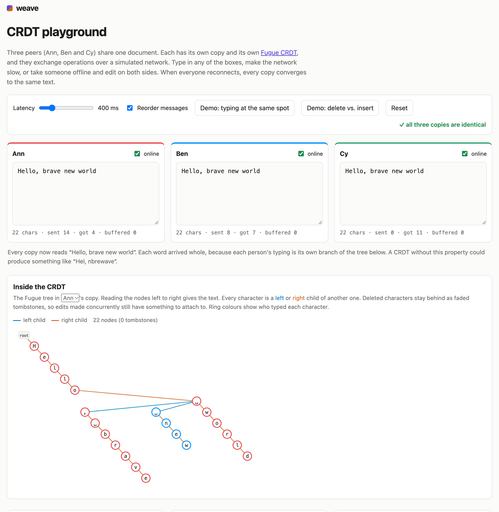
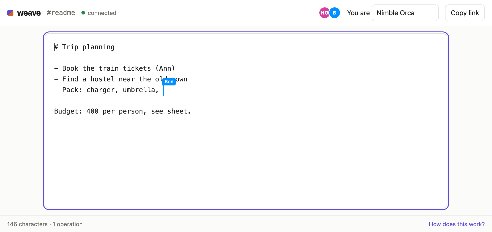

# weave: real-time collaborative editing on a CRDT built from scratch

[](https://github.com/pMag11-alt/weave/actions/workflows/ci.yml)
[](https://pmag11-alt.github.io/weave/)


weave is a collaborative text editor in the style of Google Docs. Several people edit the same
document at once, each sees the others' cursors, and anyone can go offline, keep typing and sync
when they're back. There is no locking, and the server doesn't decide whose edit wins. Every copy
of the document is a **CRDT** (conflict-free replicated data type), so every copy ends up with the
same text whatever order the edits arrive in.

Everything is written from scratch in TypeScript, with no runtime dependencies:

- the **Fugue** sequence CRDT ([Weidner & Kleppmann, 2023](https://arxiv.org/abs/2305.00583)),
  which guarantees that two people typing at the same spot never get their words interleaved
  letter by letter
- a **WebSocket server** implementing RFC 6455 on Node's `http` module: handshake, framing,
  masking, fragmentation, ping/pong, the closing handshake and UTF-8 validation
- a **sync protocol** based on version vectors, so reconnecting clients exchange exactly the
  operations the other side is missing
- a **textarea binding** that turns keystrokes into operations, applies remote edits without moving
  your caret, and gives you an undo that only reverts *your* changes

**[Try the playground](https://pmag11-alt.github.io/weave/)**: three simulated peers in one page,
with adjustable network latency, an offline switch for each peer, and a live drawing of the CRDT's
internal tree.



## Run it

```bash
git clone https://github.com/pMag11-alt/weave.git
cd weave
npm install          # only TypeScript and Node's type definitions, for the build
npm start            # builds, then serves http://localhost:8080
```

Open **http://localhost:8080/r/demo** in two windows and type in both. Kill the server or switch
off your Wi-Fi, keep typing, and when the connection comes back both windows catch up. Rooms are
saved as append-only logs in `data/`, so a restart loses nothing.



Settings come from environment variables: `PORT` (default 8080), `HOST` (default `localhost`, use
`0.0.0.0` to let other devices on your network join) and `WEAVE_DATA` (where room logs go).

There is also a small HTTP API:

```console
$ curl localhost:8080/api/rooms
[
  {
    "name": "demo",
    "length": 43,
    "ops": 2,
    "online": 2
  }
]
$ curl localhost:8080/api/rooms/demo/text
Hello from Ann!
And this line is from Ben.
```

## How it works

### Why index-based edits don't work

The obvious protocol is "insert 'x' at position 5". It breaks as soon as two people edit at the
same time. If Ben deletes the first word while Ann's "insert at 5" is still on its way, position
5 no longer means what Ann meant. Operational Transformation (the approach Google Docs took)
rewrites positions on a central server. A CRDT avoids the rewriting: it gives every character a
permanent id, and edits refer to ids instead of positions.

### The Fugue tree

In Fugue, each character is a node in a tree and has an id `(replica, counter)`. The document is
the tree's in-order traversal: a node's left children, then the node itself, then its right
children.

- **Insert** between `a` and `b`: if `a` has no right children, the new character becomes `a`'s
  right child. Otherwise it becomes the left child of the next node after `a`, which never has left
  children of its own.
- **Delete** marks the node as a tombstone. It stays in the tree because concurrent operations may
  still refer to it.
- **Siblings** on the same side are sorted by id, so every replica builds the identical tree no
  matter what order operations arrive in.

When you type a word, each letter is the right child of the one before it, so the word is one
branch. When Ann and Ben type at the same spot at the same time, their words become two sibling
branches, and an in-order traversal visits each branch whole. That's the screenshot above:
"Hello, brave new world", not "Hello, bnreawve world". Simpler CRDTs such as RGA can't rule that
interleaving out.

### Making it fast

Walking the tree for every keystroke would be O(n). weave also keeps the nodes in document order
in a **chunked list**: an array of chunks of at most 512 nodes, each caching its number of visible
characters. Converting between "the 1000th visible character" and a node then means skipping
whole chunks, and an insert is a splice into one small array. Where a new node goes in that list
follows from the tree rules: before the leftmost descendant of its next sibling, directly before
its parent, or after the last node of its parent's subtree.

Typing a word sends one operation, not one per letter. An insert op carries a run of characters
with consecutive ids, because each letter of a run is the right child of the previous one.

### Sync

Each replica keeps a **version vector**, the highest counter it has applied from every other
replica.

1. When a client connects, it sends its vector. The server replies with exactly the operations the
   client is missing, plus its own vector.
2. The client then sends up any edits it made offline that the server hasn't seen.
3. After that, operations are relayed live.

Operations can still arrive out of order. An insert can come before the character it attaches to,
for example when the network reorders messages. In that case it waits in a buffer until its
dependency shows up.

The server treats clients as untrusted. Every message is validated, malformed ones close the
connection with code 1008, and a client may only submit operations under its own replica id.

### The editor

`TextareaBinding` compares the textarea's text before and after each `input` event, using the caret
to resolve ambiguous cases like typing an `l` into "all". It applies remote edits with
`setRangeText(..., "preserve")`, which keeps your selection where it was. Undo is CRDT-aware:

- undoing your insert deletes those exact character ids, skipping any that someone else already
  deleted
- undoing your delete reinserts the text where its tombstones are

So undo never reverts a collaborator's work. Remote cursors are stored as anchors (the id of the
character to the left of the cursor), so they stay in place while other people edit around them.
They're drawn by laying the text out again in an invisible "mirror" div and measuring where the
anchor lands.

## Performance

`npm run bench` replays a real editing trace: every keystroke Martin Kleppmann made writing a LaTeX
paper ([automerge-perf](https://github.com/automerge/automerge-perf), CC BY 4.0). That's 259,778
edits producing a 104,852-character document. On an Apple M3 laptop with Node 26:

| | time | throughput |
| --- | --- | --- |
| Local editing, applied as typed | 0.32 s | ~810,000 edits/s |
| A second replica applying all the operations | 0.19 s | ~1,330,000 edits/s |

The document, including its full operation history (which sync needs), takes about 120 MB of heap.
The final text matches the trace exactly.

## Tests

```bash
npm test     # 40 tests, about half a second
```

- **Convergence properties**: two to four replicas make random concurrent edits. Operations are
  delivered in random order, in random batches and sometimes twice. Every replica must end up with
  the same text and an identical internal tree. Each run also checks that the incremental changes
  an editor receives reproduce the text exactly, and that the chunked list always matches a fresh
  in-order traversal of the tree.
- **Intention preservation**: concurrent forward and backward typing doesn't interleave, inserts
  into concurrently deleted text keep their place, and cursors follow remote edits.
- **WebSocket**: the worked examples from RFC 6455, 16- and 64-bit frame lengths fed in awkward
  chunks, every protocol violation (unmasked frames, reserved bits, oversized or fragmented control
  frames, invalid UTF-8), fragmentation with interleaved pings, and interop with Node's built-in
  WebSocket client, including a 1 MB message.
- **Server**: three clients editing concurrently converge with the server, data survives a restart,
  offline edits sync both ways after reconnecting, presence and leave events are relayed, forged
  and malformed operations are rejected, and path traversal is blocked.
- **Binding**: two editors wired together (with a fake textarea that follows the HTML spec's
  selection rules) keep each other's carets in place, and undo and redo work across remote edits.

CI runs the tests on Node 22 and 24, runs the benchmark, and deploys the playground to GitHub
Pages.

## Layout

```
src/crdt/      doc.ts (Fugue), seq.ts (chunked order-statistic list), types.ts
src/net/       websocket.ts (RFC 6455), protocol.ts (messages + validation)
src/server/    server.ts (HTTP, rooms, static files), room.ts (persistence), build-site.ts
src/client/    binding.ts (textarea <-> CRDT), cursors.ts, editor-page.ts, playground.ts
public/        index.html, editor.html, playground.html, style.css
test/          doc, websocket, server and binding tests
bench/         trace.ts (editing-trace replay)
```

## Limitations

- Plain text only, with no rich text formatting.
- The server keeps every operation forever. Compacting old tombstones safely needs every replica's
  agreement, which isn't implemented.
- No authentication: anyone who knows a room's name can edit it.
- Offline edits survive a lost connection, but not closing the tab.

## License

MIT
